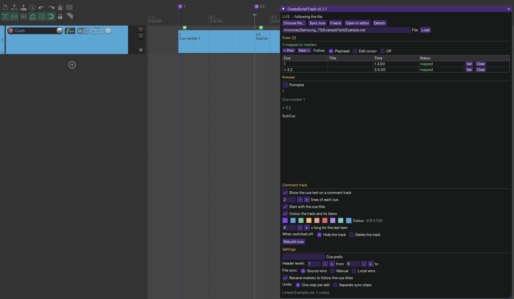

# CreateScriptTrack v0.1.1 – a Markdown cue sheet that follows the REAPER timeline



One action (`CreateScriptTrack.lua`) opens a ReaImGui window. Link a Markdown file whose **headers are cue numbers**; the cues are
mapped to **project markers**, the preview scrolls to the cue under the **playhead or edit cursor**, and an optional
**comment track** carries the first lines of every cue as text items right where the cue happens.

```markdown
# Show notes                      <- not a cue (no number)

## Q 1 Opening                    <- cue "1", marker "Q 1 Opening"
Lights fade up.
- house to half
- preset 4

### Q 1.1 Walk-on                 <- cue "1.1"
Actor enters left.

## Q 1.2.3 Door slam              <- cue "1.2.3"
SFX: door
```

## Install
**macOS (or `--portable` anywhere):** close REAPER, then `./install_mac.sh` from this folder (also finds `dist/CreateScriptTrack.lua`).
It copies the script to `Scripts/CreateScriptTrack/`, removes the download quarantine flag and registers the action in `reaper-kb.ini`
(backed up first; skipped if REAPER is running – use `--no-register` to skip it yourself). `./install_mac.sh --uninstall` removes exactly that.

**Manual:** load `dist/CreateScriptTrack.lua` as a ReaScript (*Actions → Show action list → New action → Load ReaScript…*) and run it.
Needs **ReaImGui** (ReaPack → ReaTeam Extensions). Optional: **js_ReaScriptAPI** (file dialog with a filter; syncing waits
until you release the mouse) and **SWS** (*Open in editor*). Running the action again while the window is open closes it.

## Cue headers
* A cue is a Markdown header (`#` … `######`, levels settable) whose text is an optional **prefix** and a **number**:
  `1`, `1.2`, `1.2.3` (up to 8 segments). Anything after the number is the title; `:` `-` `–` `—` `.` after the number are skipped.
* **Prefix** (Settings): `Q`, `Cue`, `SC` … case-insensitive, space optional (`Q1.2` = `Q 1.2`). Empty = bare numbers,
  which also matches headers like `## 2024 Plan`, so use a prefix if your file has those.
* Headers without a cue number are ordinary text. Headers inside code fences are ignored.
* A cue's text is everything up to the next cue header. A repeated id is flagged as a **duplicate**; the first one is used.

## Where cues sit on the timeline
Markdown has no timecodes, so **REAPER markers are the source of truth**. Each cue maps to a project marker whose name starts
with the same prefix and number (`Q 1.2 Door slam`).
* **Set** puts a cue's marker at the playhead (while playing) or the edit cursor – tap through the show while it plays.
* Markers you already have (`Q1.2 door`) are **adopted** by id and renamed to the canonical name (setting *Rename markers…*).
* A marker whose id is not in the file is an **orphan**: listed, never touched. **Remap** gives it to a cue that has no marker;
  **Delete** removes it.
* Click a row to jump to it. **Prev / Next** step through the cue markers.

## The file, and the copy in your project
* The path and a **full copy of the text** are stored inside the project (chunked in project ext-state). If the file moves
  or is deleted, the project still works from its own copy (status `FILE MISSING`).
* **File sync** (Settings): *Source wins* (default: the file is checked every second and the project follows it) ·
  *Manual* (a changed file is only reported: **Pull** or **Keep mine**) · *Local wins* (the file is ignored).
  **Sync now** reads the file whatever the mode. **Detach** drops the link and keeps the copy.
* Link a file with **Choose file…**, by typing a path, or by dropping a `.md` onto the window.

## Preview
Headers, paragraphs, bullets, `- [ ]` tasks, numbered items, quotes, rules and code blocks (inline `**bold**`, `*italic*`,
`` `code` `` and links are shown as plain text). The **current cue** is the last cue marker at or before the position;
it is marked `>` and the preview scrolls to it. **Follow**: *Playhead* (playhead while playing, otherwise the edit cursor) ·
*Edit cursor* · *Off* (the cue you click is the current one). **Prompter** shows only the current cue and the next one, large.

## Comment track
Switch on *Show the cue text on a comment track*: a track **Cues** is created as the first track, with one empty text item
per mapped cue marker. The item starts at the marker, ends at the next cue (the last one lasts *s long for the last item*),
and its notes hold the cue title and the first **n** non-empty lines of the cue. Items follow marker moves and file edits.
Only items and the track that carry CreateScriptTrack's tag are ever created, changed or deleted; your own items on that track are left alone.
Switching off hides the track (or deletes it – setting).

**Colour:** *Colour the track and its items* paints the track and every item. Pick one of eight swatches or any colour with the
colour editor; unticking it returns everything to REAPER's default colour. A new pick recolours the track and *all* its items
(also ones you coloured by hand); as long as you do not pick again, colours you give single items stay. Pure black (`#000000`) means
"no custom colour". The cue markers keep the accent colour.

## Undo
* **One step per edit** (default): syncs add no undo points. Ctrl+Z undoes *your* edit and everything is derived again.
* **Separate sync steps**: every sync that really changes something is one undo point `CreateScriptTrack: sync`.
* Every button (Set, Clear, Remap, Delete, prefix change) is one undo step.

## Settings
Cue prefix · header levels · file sync · rename markers · follow · comment lines / title / colour / last length / when off · undo mode · Freeze.
All of it is stored **in the project**, so every project has its own cue sheet and settings. **Freeze** stops writing markers and
comment items; the window keeps following.

## Not in 0.1.1
Regions from cue to cue · setext headers (`Title` over `===`) · tables and images in the preview · styled inline text ·
editing the Markdown inside REAPER (use *Open in editor*).

## Development
`./tools/run_tests.sh` builds `dist/CreateScriptTrack.lua` and runs the offline tests (Lua 5.3+) against a mock REAPER and an ImGui stub.
`DESIGN.md` explains the model; `spikes/` lists what still has to be confirmed in real REAPER, with a probe script.
**Renaming the project:** `lua tools/rename.lua NewName` (see the header of that file; `--dry-run` shows what would change). It rewrites the
names in code, file names, docs and installer, rebuilds `dist/`, and checks that nothing of the old name is left;
`test_rename.lua` renames a copy several times and back.
**Status: tested offline only – run `spikes/spike_1_probe.lua` once in REAPER before relying on it.**

MIT licence.
